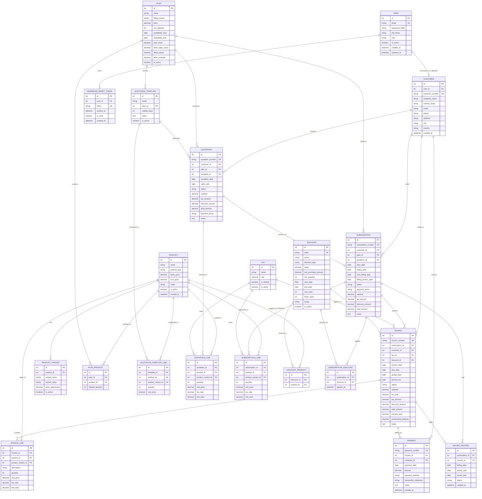

# Entity Relationship Diagram (ERD) – Brightloop Subscription Management System

## 1. Overview
The database architecture for Brightloop Software represents a fully normalized, relational schema designed for financial precision, ACID transaction isolation, and auditability.

All many-to-many ($N:M$) relationships are resolved through dedicated junction tables:
- `Plan` $\leftrightarrow$ `Product` via `PlanProduct`
- `Discount` $\leftrightarrow$ `Product` via `DiscountProduct`
- `Subscription` $\leftrightarrow$ `Discount` via `SubscriptionDiscount`
- `QuotationTemplate` $\leftrightarrow$ `Product` via `QuotationTemplateLine`

---

## 2. Mermaid Entity Relationship Diagram

