# UML Use Case Diagram – Brightloop Subscription Management System

## 1. Actors
- **Admin**: Oversees system configuration, manages staff, configures discount rules, tax rules, product variants, and reviews executive dashboards.
- **Staff**: Interacts with customers, creates quotation templates, issues quotes, converts quotes into subscriptions, manages billing operations, and records payments.
- **Customer**: Accesses the self-service portal, views assigned subscriptions, inspects invoices, and tracks payment histories.
- **Automated Billing Engine (System Actor)**: Background worker evaluating billing cycles and generating recurring invoices.

---

## 2. Mermaid Use Case Diagram

```mermaid
flowchart TD
    subgraph Actors
        A[Admin]
        S[Staff]
        C[Customer]
        SYS[Automated Billing Engine]
    end

    subgraph User & Security
        UC1[Register Customer Account]
        UC2[Login & Authenticate]
        UC3[Request Password Reset]
        UC4[Manage Staff Accounts]
    end

    subgraph Catalog & Rules
        UC5[Manage Products & Variants]
        UC6[Manage Subscription Plans]
        UC7[Configure Tax Rates]
        UC8[Configure Discount Rules]
    end

    subgraph Sales & Quotations
        UC9[Manage Quotation Templates]
        UC10[Generate Customer Quotation]
        UC11[Convert Quotation to Subscription]
    end

    subgraph Subscription Lifecycle
        UC12[Create & Manage Subscriptions]
        UC13[Pause / Resume Subscription]
        UC14[Close / Renew Subscription]
        UC15[View My Subscriptions]
    end

    subgraph Invoicing & Payments
        UC16[Auto-Generate Recurring Invoices]
        UC17[Confirm / Cancel Invoices]
        UC18[Record Invoice Payments]
        UC19[View & Download Invoices]
    end

    subgraph Reporting & Analytics
        UC20[View Executive Financial Analytics]
        UC21[Track Overdue Invoices & Receivables]
        UC22[View Customer Self-Metrics]
    end

    C --> UC1
    C --> UC2
    C --> UC3
    C --> UC15
    C --> UC19
    C --> UC22

    S --> UC2
    S --> UC3
    S --> UC5
    S --> UC6
    S --> UC9
    S --> UC10
    S --> UC11
    S --> UC12
    S --> UC13
    S --> UC14
    S --> UC17
    S --> UC18
    S --> UC19
    S --> UC21

    A --> UC2
    A --> UC3
    A --> UC4
    A --> UC5
    A --> UC6
    A --> UC7
    A --> UC8
    A --> UC9
    A --> UC10
    A --> UC11
    A --> UC12
    A --> UC13
    A --> UC14
    A --> UC16
    A --> UC17
    A --> UC18
    A --> UC19
    A --> UC20
    A --> UC21

    SYS --> UC16
```

