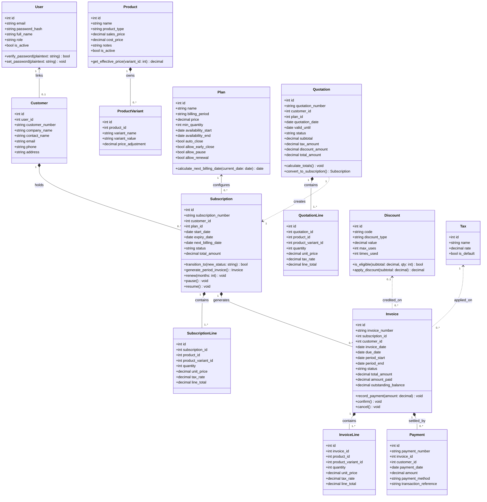

# UML Class Diagram – Brightloop Subscription Management System

## 1. Architectural Model
The backend domain model is architected following clean object-oriented domain modeling patterns, decoupling data entities, business rules, state machines, and repositories.

---

## 2. Mermaid Class Diagram

